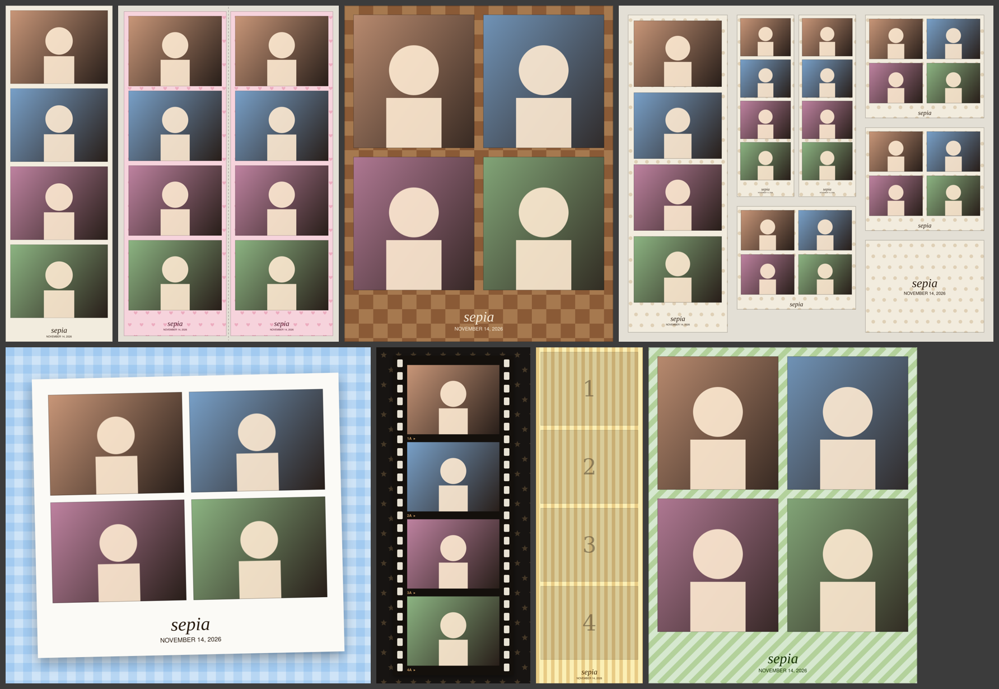

# Sepia

A classic-style photobooth called Sepia that runs in your browser. Pick a layout, pattern and color, hit start, and it takes 4 photos with a countdown, then builds a print you can download as a PNG.

Built with plain HTML, CSS and JavaScript. No frameworks, no build step, nothing to install.



*(Preview uses placeholder portraits. The real app uses your camera.)*

## Features

- Live webcam preview (mirrored, like a real mirror)
- 3-2-1 countdown with camera flash effect
- **6 print layouts**
  - Classic strip (4 photos)
  - Double strip (two identical strips, ready to cut)
  - 2x2 grid
  - Combo (long strip + mini strips + mini grids)
  - Polaroid
  - Film strip
- **8 background patterns:** Plain, Polka dots, Stripes, Diagonal, Checkerboard, Gingham, Hearts, Stars
- **7 colors:** Cream, Noir, Bronze, Rose, Sky, Butter, Sage
- **7 photo filters:** Normal, B&W, Sepia, Vintage, Cool, Warm, Pop
- Live print preview that updates as photos are taken. Change layout, pattern or color even after shooting
- One-click PNG download
- 100% private: photos stay on your device and are never uploaded

## Try it

**Online:** if this repo has GitHub Pages enabled, open the link in the repo's "About" section.

**Locally:** download the project and open `index.html` in Chrome, Edge, Firefox or Safari. Allow camera access when asked.

If your browser blocks the camera when opening the file directly, run a tiny local server instead:

```
python -m http.server 8000
```

then visit http://localhost:8000.

## Publish it with GitHub Pages (free)

1. Push this project to a GitHub repository.
2. Go to **Settings > Pages**.
3. Under "Build and deployment", set Source to **Deploy from a branch**, choose `main` and `/ (root)`, then Save.
4. After a minute Sepia is live at `https://YOUR-USERNAME.github.io/REPO-NAME/`.

## Project structure

```
sepia/
├── index.html    # the whole app (HTML + CSS + JS)
├── preview.png   # image used in this README
├── LICENSE
└── README.md
```

## Customize

Everything is in `index.html`:

- **Colors:** edit the `THEMES` list near the top of the script (`bg`, `fg` for the pattern, `ink` for text)
- **Patterns:** add a new case in `paintPattern()` and a name in `PATTERNS`
- **Layouts:** add a name in `LAYOUTS` and a new branch in `draw()`

## Ideas for improvement

- Stickers and hats drawn on top of the photos
- Choose how many photos to take (2, 3, 4 or 8)
- Camera picker for computers with more than one camera
- Sound effects for the countdown and shutter

## License

MIT License. See [LICENSE](LICENSE).
